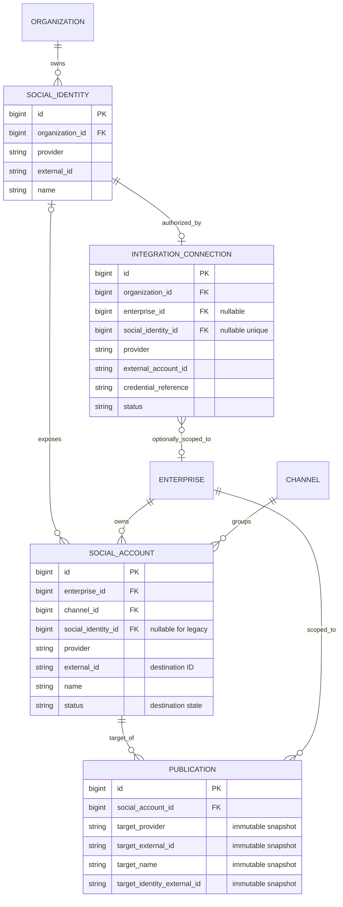

# Social Publishing Domain Model

## Ownership and relationship decisions

- **Organization owns SocialIdentity.** A social identity is the authenticated external principal returned by a network OAuth flow. Its network key and opaque external identifier are immutable. The same external principal may be connected independently by different CR8OR organizations, so identity uniqueness is scoped to `organization_id + provider + external_id`, not global.
- **IntegrationConnection owns authorization state and the credential reference.** It remains the existing generic integration boundary rather than introducing a second social-token store. A social-linked connection references one SocialIdentity; the provider and external account identifier must match that identity. Its status and credential reference are the only source of truth for grant state and credential lookup.
- **SocialAccount is a publishable destination.** It remains enterprise-owned and channel-bound. Its `external_id` identifies the destination (for example a Page or professional account), not the authenticated principal. A SocialIdentity may own multiple destinations. Destination identity is unique by `social_identity_id + external_id`; legacy unlinked destinations are unique by `enterprise_id + provider + external_id`.
- **A social identity has at most one current IntegrationConnection record.** The unique foreign key prevents competing active grants for the same identity. Reauthorization rotates the credential reference on that record. This keeps status and credentials singular; provider-grant history is not modeled as separate duplicate rows.
- **Connection scope is organization-owned by default.** `IntegrationConnection.enterprise_id` remains nullable. An organization-scoped connection may authorize destinations across its organization; an enterprise-scoped connection may only authorize destinations in that enterprise. `SocialAccount.enterprise_id` and `Channel.enterprise_id` remain immutable ownership boundaries.
- **Legacy destinations are not falsely assigned an authenticated identity.** Existing `SocialAccount` rows are left with nullable `social_identity_id` until an actual OAuth identity is established. Existing provider and destination identifiers are preserved. The migration changes duplicate detection from unsafe global provider/external-ID uniqueness to enterprise-scoped uniqueness for legacy destinations.
- **Publication target snapshots are immutable.** Every newly created Publication snapshots network key, destination external ID, destination name, and authenticated identity external ID when available. Existing publications are backfilled from their current SocialAccount relation. These snapshots preserve historical attribution after account rename, disconnect, reconnect, or future identity relinking.

## Relationship diagram

## Lifecycle contract

- Destination lifecycle (`SocialAccount.status`) describes whether a destination is enabled in CR8OR. It does not represent OAuth or grant health.
- Grant lifecycle (`IntegrationConnection.status`) is canonical: `active`, `disabled`, `degraded`, `expired`, `reconnect_required`, or `revoked`. Only `active` is operational. Revoked/expired/reconnect-required grants can return to active only through the explicit reauthorization method with a new credential reference.
- `pending_authorization` is deferred until issue #521 implements an actual OAuth initiation/callback lifecycle; persisting a fake pending grant before an authorization flow exists would misrepresent state.
- The connection record stores a credential reference, never raw access tokens, refresh tokens, authorization codes or client secrets.
- This issue establishes identity/ownership relationships and historical target snapshots. It does not implement OAuth, destination discovery, network publishing adapters, or publish-time active-grant enforcement; those are handled by issues #521 and #522.

## Migration and rollback

The migration adds the identity table, optional relationships and publication snapshots. Existing SocialAccount rows remain unlinked because their stored destination IDs cannot prove the external authenticated principal. Existing Publication snapshots are backfilled from SocialAccount. Rollback checks for provider/external-ID collisions before restoring the previous global unique constraint and fails explicitly rather than silently losing the new supported organization/enterprise scope.
